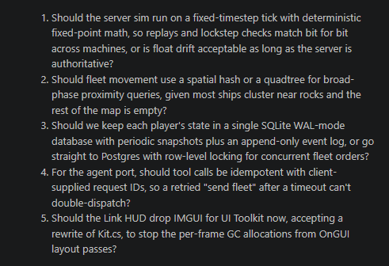
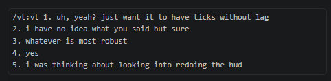
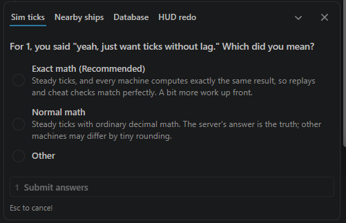
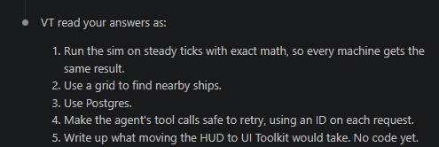

# VT: the Vibecoder Translator

## Has this ever happened to *you?*

Your agent asks you five careful questions.



And you answer the way people actually answer.



Then the agent picks a meaning for "sure" and builds it. Hours later you find out what you agreed to.

**There's got to be a better way!**

## Introducing VT, the Vibecoder Translator

VT reads your short answers before the agent acts. The clear ones it spells out as instructions. The unclear ones it checks with you, in plain words.



Then it shows the agent exactly what you meant, and nothing you didn't.



Without VT, a bare "no" to "API server only?" became "so it goes on every server" in our tests: a decision nobody made.

## The rules it follows
- **Faithful, not creative.** "yes" stays yes, "no" stays no, "not yet" stays not yet, "sort of" stays partial.
- **A "yes" to "A or B? I'd do A" means A.** That's what you agreed to.
- **It adds nothing.** No new steps, tests or conditions that neither of you said.
- **It keeps your changes.** "yes but on both servers" means the agent's plan, on both servers.
- **It asks only when it has to:** soft words, a "no" with no alternative, an answer that could cover more than was proposed. In Claude Code you pick from a list; elsewhere you answer "1a" or "2b".

## Install

**Claude Code** (a plugin, with auto mode):
```
/plugin marketplace add Siigari/vt
/plugin install vt@vt
```
Then type `/vt yes / no`. **Auto mode** is on: when Claude just asked you questions and your reply is short, it reads your reply with VT without being asked. Turn it off with the environment variable `VT_AUTO=0`. Auto mode needs `node` on your PATH.

For the agents below, get the files first: `git clone https://github.com/Siigari/vt`.

**Codex:** copy `skills/vt` to `~/.codex/skills/vt` (or a project's `.agents/skills/vt`), then type `$vt yes / no`.

**Gemini CLI:** copy `gemini/commands/vt.toml` to `~/.gemini/commands/` (or a project's `.gemini/commands/`), then type `/vt yes / no`.

**Grok Build** (xAI's `grok`): Grok reads Claude Code plugins, so `grok plugin install Siigari/vt --trust` installs the same package, auto mode included. Or copy `skills/vt` to `~/.grok/skills/vt`. Project skills only load in folders you've trusted.

**Anything else** (Cursor, a chat app): paste `PROMPT.md` into its rules, `AGENTS.md` or custom instructions. It then applies VT whenever you answer its questions in a few words.

## Files
- `skills/vt/SKILL.md`: the rules, and the only file to edit. Claude Code and Codex read it as is.
- `hooks/`: Claude Code's auto mode (`auto.js`, a UserPromptSubmit hook). It never blocks a prompt.
- `build.js`: regenerates `gemini/` and `PROMPT.md` from `SKILL.md` (`node build.js`).
- `.claude-plugin/`: the Claude Code plugin and its one-plugin marketplace.

## Tested
- Claude Code 2.1.280 on Sonnet 5.5, with `--plugin-dir` and the picker: `/vt` and `/vt:vt` both work. Auto mode fires on short answers to questions, and stays quiet after a message with no questions, on long replies and on slash commands.
- Codex 0.162 on GPT-6.1 Sol: `$vt` works, and unclear answers are checked as 1a/1b.
- Gemini CLI 0.63 (API key): `/vt` works through `-p` and `--resume`, and unclear answers are checked as 2a/2b.
- Grok Build 1.0.50: `grok plugin install Siigari/vt --trust` installs it from GitHub. `/vt` and auto mode both work in one-shot mode on its default model: clear answers spelled out, unclear ones listed as 2a/2b, nothing guessed. **Untested on Grok's higher-quality models and in interactive sessions: feedback welcome.** (Grok won't install it by name from this repo's marketplace file, so use the direct command.)
- Installing from GitHub: tested in Claude Code (`/plugin marketplace add Siigari/vt`, then `/plugin install vt@vt`; auto mode works from the install) and Grok (the direct command above).
